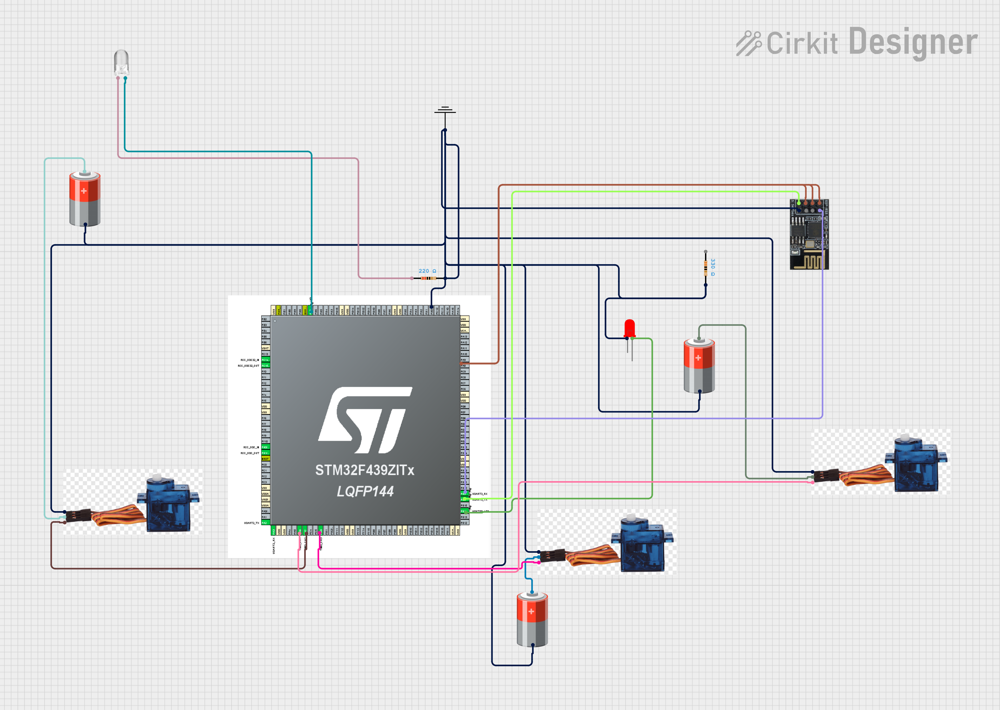

# 🏠 SmartHouse: Voice-Controlled Home Automation on STM32

A smart home system where you **speak naturally** ("it's cold in here", "open the door") and the house reacts. A mobile app captures the voice command, an **AI workflow (n8n + local LLM via Ollama)** turns it into structured commands, and an **STM32F439** microcontroller drives the lights, heater, door, window and fan.

ECE355 (Embedded Systems) team project at MedTech – South Mediterranean University.



## Architecture

```
 Mobile app (Thunkable)            n8n workflow + LLM (Ollama)          STM32F439 + ESP8266
 ───────────────────────  HTTP ──▶ ─────────────────────────── HTTP ──▶ ──────────────────────
 voice / text input                 infers intent from the sentence     HTTP server over Wi-Fi
 speech-to-text                     → "heater on;close window"          (ESP8266 AT commands, UART)
                                                                        → GPIO LEDs + PWM servos
```

1. **Mobile app (Thunkable):** captures a voice or text command and sends it to n8n.
2. **n8n + LLM:** a constrained system prompt makes the model output only allowed actions, e.g. `fan on;close window`.
3. **STM32 firmware:** runs a small **HTTP server** on an ESP8266 (AT commands over UART3), splits multiple commands, and executes them.

## Firmware highlights (`firmware/Core/Src/main.c`)

- **ESP8266 driver** over UART with interrupt-driven RX and a 4 KB ring buffer
- **Multi-connection HTTP server** (up to 5 links) with request reassembly, `Content-Length` parsing and timeouts
  - `GET /status`: health check; `GET /last`: last command received
  - `POST /msg`: one or more commands separated by `;`, new lines, "and" or "then"
- **Actuators**
  - Light & heater: GPIO outputs
  - Door & window: servos on TIM3 PWM (1 µs ticks, 20 ms period)
  - Fan: servo sweep at a fixed interval
- Supported commands: `light on/off`, `heater on/off`, `open/close door`, `open/close window`, `fan on/off`, plus a "reverse" for the door and window

## Hardware

STM32 Nucleo-144 (STM32F439ZI) · ESP8266 Wi-Fi module · servo motors · LEDs

## Build & flash

1. Open `firmware/` as a project in **STM32CubeIDE** (the `.ioc` file holds the pin configuration).
2. Set `WIFI_SSID` and `WIFI_PASS` at the top of `Core/Src/main.c`.
3. Build and flash to the Nucleo board. The board's IP is printed after it joins Wi-Fi (`AT+CIFSR`).
4. Test it: `curl -X POST http://<board-ip>/msg -d "light on;open window"`

## Tech stack

C · STM32 HAL · STM32CubeIDE · ESP8266 (AT commands) · UART · PWM · HTTP · Thunkable · n8n · Ollama (LLM)

## Team

Amine Ben Nasrallah · Adem Arroum · Asser Hermassi · Houssem Rafraf. Advisor: Noura Baccar.

📄 [Final report](docs/final-report.pdf) · 📊 [Slides](docs/slides.pdf)
